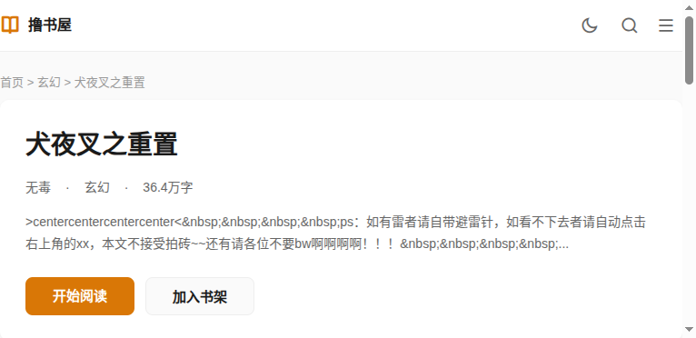

# 撸书屋 · 小说站点

线上演示站点：[https://www.lushuwu.com/](https://www.lushuwu.com/)

> **内容提示**：演示站含成人向作品，仅限年满 18 周岁用户访问。本仓库面向技术交流与二次开发，请遵守当地法律法规与内容合规要求。

[](https://openjdk.org/)
[](https://spring.io/projects/spring-boot)


## 商务合作

合作形式：

1. **广告合作** — 站点广告投放与商务对接
2. **技术合作** — 搭建同类小说站点、基于本站点二次开发，或定制开发各类网站、APP

联系方式：Telegram [@lushuwu](https://t.me/lushuwu)


## 在线预览

| 入口 | 说明 |
|------|------|
| [正式站 www.lushuwu.com](https://www.lushuwu.com/) | 前台阅读站 |

<p align="center">
  
  <br/>
  <sub>访问前年龄确认</sub>
</p>

<p align="center">
  
  &nbsp;
  
  <br/>
  <sub>首页推荐 · 书籍详情</sub>
</p>

<p align="center">
  
  <br/>
  <sub>章节阅读（主题 / 字体 / 翻页工具栏）</sub>
</p>

## 功能概览

**读者端（novel-front）**

- 首页推荐、分类浏览、最新更新、排行榜、搜索
- 书籍详情、目录、章节阅读（主题色 / 字号 / 深色模式）
- 用户注册登录、书架、阅读历史、评论
- 18+ 年龄门（不影响爬虫抓取正文 HTML）
- SEO：Sitemap、规范化链接、模板化 title / description
- 发布页入口与备用域名解析

**管理端（novel-admin）**

- 小说 / 章节 / 分类 / 评论管理与回收站
- 会员、反馈、友链、站点信息、发布域名

**运维与工具**

- 小说批量导入脚本（`tools/novel_import`）


## 快速开始

### 环境要求

- JDK 21+
- Maven 3.8+
- MySQL 8.x
- Redis


### 配置

按环境修改配置（**请勿将真实密码提交到仓库**）：

默认端口：

| 模块 | 端口 |
|------|------|
| novel-front | `8083` |
| novel-admin | `8080` |

### 启动

```bash
# 前台
cd novel-front && mvn spring-boot:run

# 后台（另开终端）
cd novel-admin && mvn spring-boot:run
```

访问：

- 前台：<http://localhost:8083/>
- 后台：<http://localhost:8080/>

生产环境建议使用已打包的 jar，并由 Nginx / Caddy 做 HTTPS 反代（项目已开启 `forward-headers-strategy: framework`）。

## 小说批量导入

在**项目根目录**执行。新服务器首次部署：

###  系统依赖

```bash
sudo apt-get update
sudo apt-get install -y python3-venv python3-full
```


依赖：`PyYAML`、`PyMySQL`、`Pillow`。

###  配置并运行

```bash
cp tools/novel_import/config.example.yaml tools/novel_import/config.yaml
# 编辑 MySQL、pic 路径、data_root 等

python -m tools.novel_import
# 或指定配置：
python -m tools.novel_import -c tools/novel_import/config.yaml
```


---

**撸书屋** · 海量网络小说在线阅读 · [lushuwu.com](https://www.lushuwu.com/)
